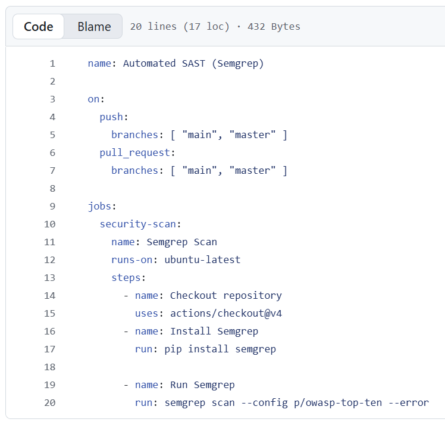
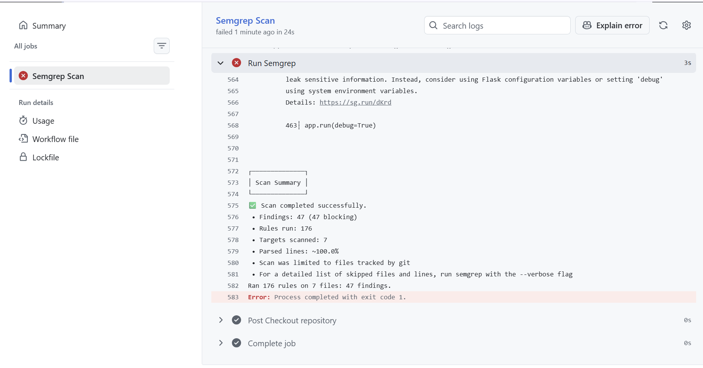
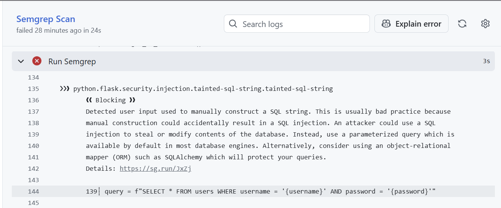
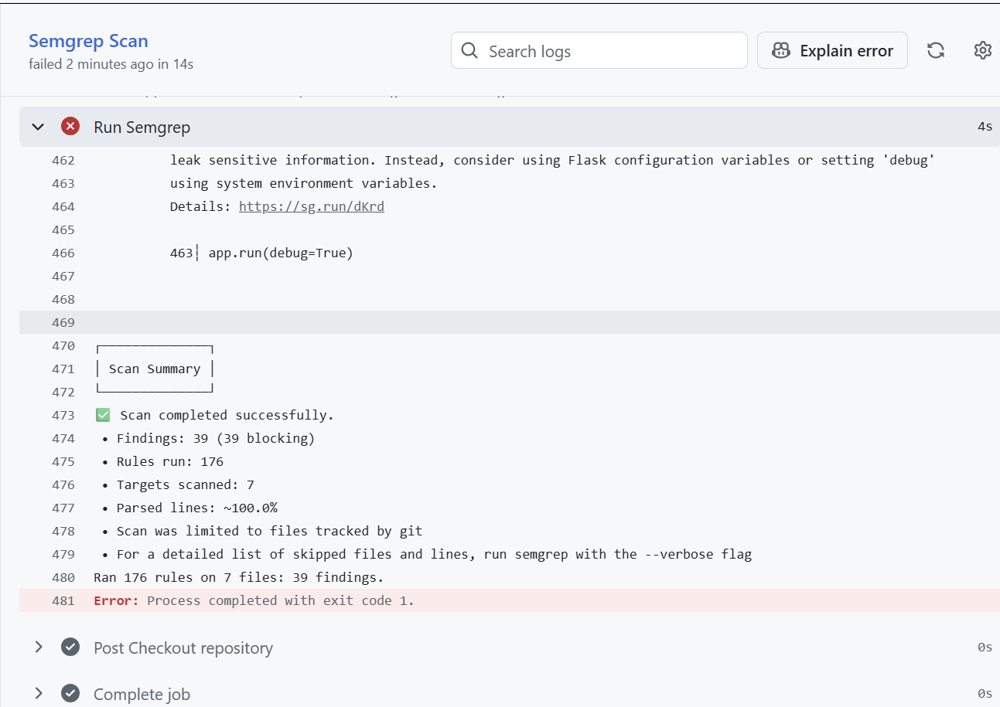
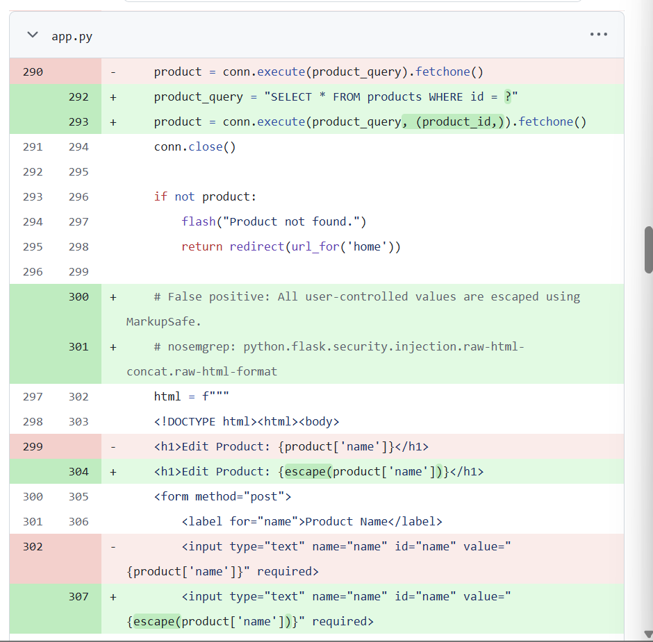
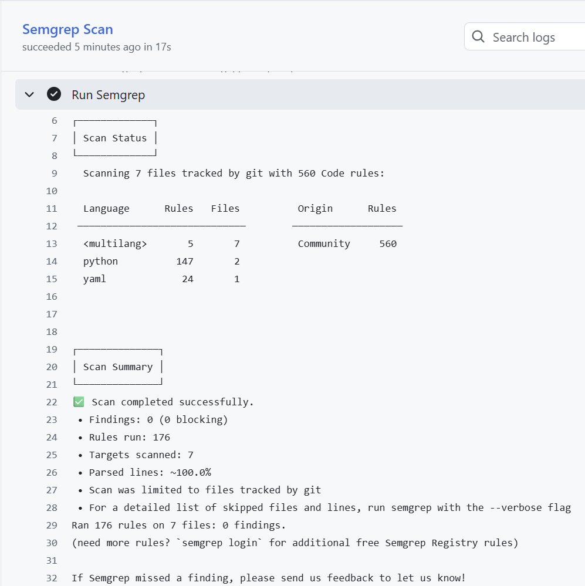
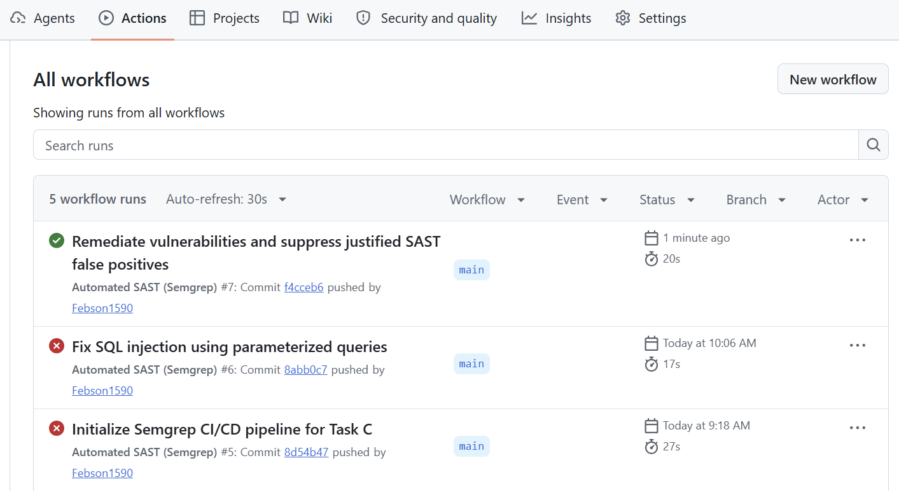

# Task C — Automated Security Testing

## 1. Task Overview

Automated security testing was integrated into the web application using GitHub Actions and Semgrep. The pipeline performs Static Application Security Testing (SAST) on every push or pull request sent to the main or master branch. The goal is to find vulnerabilities in the application, fix real security issues, review false positives and run further scans to ensure that the fixes are effective.

## 2. Tools and Pipeline Configuration

Semgrep and GitHub Actions were used to automate security testing.

**Semgrep:** It scans the source code for potential security vulnerabilities, without executing the application.

**GitHub Actions:** A CI/CD automation platform that automatically triggers security scans when code changes are pushed or pull requests are made to the main/master branch.

The pipeline is set up in `.github/workflows/semgrep-sast.yml` and uses the OWASP Top Ten ruleset to detect possible security vulnerabilities in the source code.

The `--error` flag was added to cause the pipeline to fail if any security findings were reported.

_Figure 1: Initial Semgrep workflow configuration._

## 3. Initial Security Scan

The initial automated scan identified 47 security findings in 7 files and used 176 security rules. The pipeline failed due to security findings being detected.

One of the vulnerabilities detected was SQL injection. This was due to the user input being directly inserted into the SQL query. Reported results were examined to filter out real security problems from false positives before changes in the source code were made.

_Figure 2: Initial Semgrep scan reporting 47 findings._

## 4. Security Fixes

### SQL Injection

The initial scan found SQL injection vulnerabilities because f-strings were used to insert user input directly into SQL queries. This could allow an attacker to modify database queries, bypass a security authentication or gain access to unauthorised data.

_Figure 3: SQL injection vulnerability identified by Semgrep._

In order to fix this issue, insecure SQL queries were replaced with parameterised queries. This keeps the user input separate from the SQL instructions so that it doesn't affect how the query is executed.

An additional automated scan was conducted after implementing these fixes. The number of findings went down from 47 to 39, which means that eight reported findings were fixed for SQL injection.

_Figure 4: Scan results after fixing SQL injection vulnerabilities._

### Cross-Site Scripting (XSS)

Semgrep also found possible XSS vulnerabilities where user input is displayed directly in HTML. This could allow an attacker to inject malicious scripts into web pages.

To reduce this risk, MarkupSafe was used to escape user controlled values before displaying them in HTML.

### Insecure Configuration

Two security issues were identified in the application and pipeline configuration:

- **Flask debug mode:** Debug mode was enabled (`debug=True`) which could have exposed some sensitive app information. This was fixed by setting `debug=False`.
- **GitHub Actions checkout:** The checkout action used a version tag (`actions/checkout@v4`). This was replaced with a specific commit hash to reduce the risk of unexpected or unauthorised changes to the pipeline.

## 5. False Positive Triage

There were nine possible XSS findings that still existed after fixing the security issues that were found. The findings were reviewed for real security risks. The affected code was examined to confirm that user controlled values were escaped with MarkupSafe before being displayed in HTML.

The findings were classified as false positives and suppressed with `nosemgrep` comments . Each suppression included the applicable Semgrep rule ID and a technical explanation of why the finding was deemed a false positive.

Instead of turning off security checks for the whole application, only specific rules were suppressed. This way, Semgrep can still find similar issues in other parts of the code.

_Figure 5: False positive suppression with technical justification._

## 6. Final Scan Results

After fixing the identified security issues and reviewing the false positives, the automated security scan was run again.

The final scan reported zero findings, and the GitHub Actions workflow completed successfully.

_Figure 6: Final Semgrep scan reporting zero findings._

The workflow history shows the progress from the initial failed scan to the final successful scan, demonstrating the improvements made to the application and pipeline configuration.

_Figure 7: Progression from failed to successful security scans._

Although the final scan reported zero findings, this does not guarantee that the application is completely secure. Semgrep can only detect issues covered by its configured security rules.
